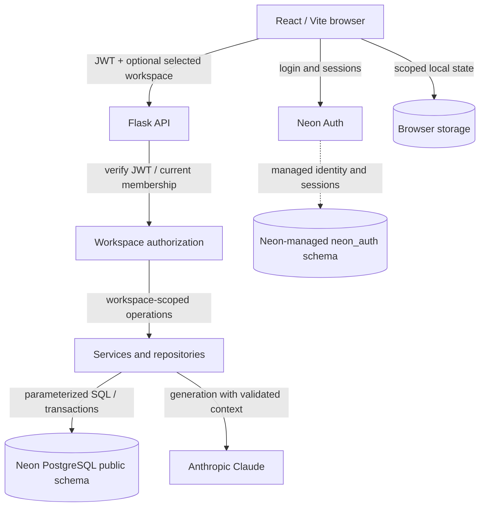
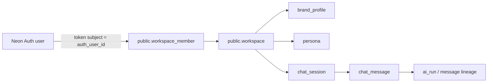

# Lucie database and backend architecture

> **Baseline:** Neon PostgreSQL `development` schema inspection supplied October 23, 2026; application behavior reviewed against GitHub branch `codex/step-j-chat-persistence` and its current feature/authorization/environment documents. This is a **development architecture reference**, not a production deployment or complete live-test certification. [Quick overview](README.md) · [Full schema](SCHEMA.md) · [Workflows](WORKFLOWS.md).

## 1. System boundaries



- **React/Vite:** UI, auth session, explicit workspace selection, persona confirmation, local unsent composer/pending state, archived/history views, calendar and local legacy data. The browser is **not** the database trust boundary.
- **Neon Auth:** account registration, managed identities, sessions and JWT signing keys. `neon_auth.*` is provider-managed; do not mutate it as an application migration.
- **Flask:** independently validates the bearer token, resolves a *current* recognized `public.workspace_member`, checks capability, and enforces selected workspace scope per request.
- **Repositories:** own parameterized PostgreSQL reads/writes and transactional boundaries; services assemble prompt context, enforce operation contracts and orchestrate generation.
- **Claude:** stateless generation provider; the database persists previous conversation context and successful outputs. Claude does not acquire persistent memory simply from previous API calls.

The backend must never accept a client-asserted member ID, role, authorship, business identity, licensed identity, or model-output envelope as authoritative.

## 2. Identity versus authorization



`workspace_member.auth_user_id` is a **text mapping** to an identity managed by Neon Auth. In the inspected `public` schema it is **not a PostgreSQL foreign key** to `neon_auth.user`. This deliberate cross-schema link is validated by trusted application/auth flows, not by assuming a hard FK exists. Neon Auth's own `organization`/`member` tables are **not substitutes for** Lucie's `public.workspace`/`public.workspace_member` authorization model.

**Current onboarding choice:** accounts can be registered without permission to use Lucie. The team manually provisions valid workspace memberships; no automatic invitation, role-management UI or default workspace is created. `GET /api/workspaces` lists current recognized memberships. One membership resolves automatically; multiple require an explicit selection; none means protected workspace operations are denied. A selected workspace ID is an *input for checking access*, never permission by itself.

Backend source of truth: `server/auth/workspace_context.py` (`list_user_workspaces`, `resolve_user_workspace`, `require_workspace`), `server/auth/permissions.py`, and `server/auth_utils.py`. The browser transport is `client/src/lib/authenticatedApi.js`.

### Roles and capabilities

| Role | Read workspace/chat | Create/write/generate chat | Edit brand and personas |
|---|---|---|---|
| `owner`, `admin` | Yes | Yes | Yes |
| `developer` | Yes | Yes | Only in `development` or `test` *workspace environment* |
| `member` | Yes | Yes | No |
| `viewer` | Yes | No | No |

Current Step J policy: chats are **workspace-shared**, not creator-private. `created_by_member_id` and `author_member_id` preserve attribution; they do not grant cross-workspace access. Previously saved workspace chats may become visible to other authorized members when sharing-enabled code is deployed. Archived status affects the whole workspace. These are behavior contracts in the reviewed feature branch; live multi-account verification and production release checks remain pending. See [`../WORKSPACE_CHAT_SHARING.md`](../WORKSPACE_CHAT_SHARING.md) and [`../AUTHORIZATION_MATRIX.md`](../AUTHORIZATION_MATRIX.md).

### HTTP and database error boundaries

A missing/invalid JWT leads to authentication rejection; no membership leads to workspace denial; ambiguous workspace selection requires an explicit choice; insufficient role capabilities reject writes/generation; foreign session/persona resources are not disclosed. See the authorization matrix for exact HTTP mappings and route-specific exceptions. Generic errors must not leak SQL, secrets, raw JWTs, or another workspace's private text.

## 3. Database organization and schema status

The current export contains **24 `public` tables**, **9 managed `neon_auth` tables**, **50 public foreign-key constraints**, **51 public indexes**, **13 application triggers**, and extensions `pg_session_jwt`, `pgcrypto`, `plpgsql` and `vector`. There are **no RLS policies in `public`**, and `relrowsecurity` is false for every inspected application table.

Functional clusters:

| Cluster | Tables | Meaning |
|---|---|---|
| Workspace and configuration | `workspace`, `workspace_member`, `brand_profile`, `persona`, `member_preference` | Identity mapping, authorization boundary, shared business context, and potential synced preferences |
| Conversation | `chat_session`, `chat_message`, `chat_summary` | Sessions, saved messages/revisions and future summaries |
| AI execution/provenance | `ai_run`, `tool_call`, `web_source`, `message_source` | Runs, metrics, and supporting provenance schema |
| Long-term semantic memory | `memory_item`, `ai_run_memory`, `feedback_event` | Future durable facts/preferences/corrections and run attribution |
| RAG/reference retrieval | `retrieval_document`, `retrieval_chunk`, `ai_run_retrieval` | Future normalized source docs, vector chunks and retrieval provenance |
| Marketing/CRM | `campaign`, `campaign_persona`, `content_item`, `calendar_entry`, `contact`, `lead` | Future structured planning, published content and light lead tracking |

**Do not equate 'table exists' with 'feature exists.'** The application currently uses workspace, brand/persona and durable chat/AI-run storage. Long-term semantic memory, automatic summarization and vector RAG workflows remain future work. Browser calendar/legacy history are not synchronized via the similarly named PostgreSQL tables.

Detailed definitions, nullability/defaults, every FK and index appear in [SCHEMA.md](SCHEMA.md), derived from the uploaded snapshot—not from the original proposed SQL file.

## 4. Configuration and prompt-context assembly

A saved **brand profile** belongs to one workspace (`brand_profile.workspace_id` is unique) and stores `business_name`, licensing numbers, tone, values, keywords, catchphrases, banned words, writing examples and supplemental compliance text. The approved licensed person's name lives in `brand_profile.settings.licensed_person_name`; it is **not** a separate SQL column. Other JSON settings keys are not generally injected into generation prompts.

A **persona** also belongs to a workspace and carries `slug`, `name`, `description`, `audience_profile`, `prompt_guidance`, `is_starter` and `deleted_at`. Active reads exclude soft-deleted rows. A saved chat locks its persona; editing the active persona selection for an existing chat is not an implicit persona change.

Actual execution path:

```text
verified workspace + ai:generate capability
    -> selected persona UUID from the authorized workspace
    -> get_persona(workspace_id, persona_id)
    -> get_brand_profile(workspace_id)
    -> validate required licensing/identity and bounded configuration
    -> fixed backend generation policies + untrusted brand/persona context
    -> Claude request
```

Core implementation: `server/services/generation_context.py`, `server/services/prompt_builder.py`, `server/services/generation_policy.py`, `server/repositories/brand_profile_repository.py`, `server/repositories/persona_repository.py`.

Required validated generation identity includes the business name, licensed person's name (`settings.licensed_person_name`), NMLS ID and DRE number. Missing/invalid data results in a configuration error **before** a provider call. The system's fixed compliance/disclosure policies remain in code; a user-editable compliance footer is supplemental, not an override. Stored brand and persona text is **untrusted prompt context**, even though it came from an authorized workspace.

## 5. Saved chat, AI operations and context

Step J's durable path uses:

- `chat_session`: workspace-owned conversation, creator attribution, locked `default_persona_id`, archive state and timestamps.
- `chat_message`: immutable user/assistant records, typed/structured payloads, attribution, request/source links and client idempotency key.
- `ai_run`: provider/model, prompt hash/version, outcome and token/latency metrics. Failed/started runs can have no response message.
- **Structured JSON on messages:** operation state, claim/recovery information, linked revisions and media specifications. The Step J collaboration patch reports **no new SQL table or schema migration**; state is built on existing tables/columns and guarded repository transactions.

A new chat is only saved when the first Send occurs. The client creates a stable UUID and saves a pending request identifier locally before dispatch, then uses idempotent `PUT /api/chat/sessions/{id}` and `POST /api/chat/sessions/{id}/operations`. The backend claims an operation durably before invoking the provider. It saves the result and final AI run outcome together; it does **not** automatically repeat a paid provider call after an uncertain outcome. A status GET never generates new output. A deterministic 'Make it shorter' operation is not a new model run.

**Context is bounded, not unlimited memory:** `server/services/conversation_context.py` captures up to six recent completed exchanges and a 16 KiB history projection from the *same* session, with a per-artifact limit. Recent idea avoidance uses a separate bounded window of completed outputs in the selected workspace; it does not turn all workspace history into the prompt. No automatic long-term summary, semantic memory extraction or RAG retrieval is in this implementation.

Saved messages/revisions persist across supported browsers and can be shared within the authorized workspace. Legacy browser history remains read-only/local; pending inputs and calendar remain browser-scoped. Export is supported; automatic history import is **not**.

For exact endpoint and recovery details, use [`../STEP_J_FEATURE_AND_OPERATIONS_GUIDE.md`](../STEP_J_FEATURE_AND_OPERATIONS_GUIDE.md) and [WORKFLOWS.md](WORKFLOWS.md).

## 6. Database security model and limitations

- All protected API access relies on a verified Auth identity **and** current workspace membership **and** the appropriate capability. Every repository operation must constrain records by the authorized workspace or verify ownership through a workspace-scoped parent.
- The development database snapshot has **RLS disabled on every `public` table** and no `public` RLS policies. This does *not* demonstrate a broken route, but it means PostgreSQL itself is **not** the current tenant-isolation safety net. Server-side filters, privileges and tests are crucial. Review RLS and least-privilege DB roles before production.
- `workspace.environment` is an **application row value**, not proof of which Neon branch you're connected to. Its SQL default is `'production'` even inside a development database. Controlled workspace creation should set and verify its intended environment explicitly.
- `workspace_member` currently has no physical `revoked_at` column in the inspected export. Compatibility code checks an optional key via JSON, but **soft revocation is not implemented solely by that check**. Removing a membership denies subsequent requests; in-flight calls have separate limitations.
- Hard-coded or client-supplied role/workspace, status/claim, authorship and identity values must not bypass server checks. Do not weaken requirement for a committed operation claim before provider dispatch.
- Schema metadata does not prove absence of over-privileged database credentials, successful browser integration, correct production configuration or safe deployment.

## 7. Development, staging and production

| Layer | Development (current) | Production (future / separate verification) |
|---|---|---|
| Neon branch | Team-selected `development` branch; snapshot inspected | Approved production branch, **not assumed identical** |
| Auth | Matching development Neon Auth endpoint | Matching production Auth endpoint |
| Accounts/roles | Controlled test accounts and manually assigned memberships | Real approved accounts, ownership and least-privilege roles |
| Data | Synthetic/test data; no routine real-customer tests | Real client data subject to privacy, backup and operational controls |
| Backend secrets | Local ignored `server/.env` | Hosting secret manager / deployment variables |
| Browser Auth URL | Local ignored `client/.env` | Hosting build/runtime configuration (browser-exposed URL only) |
| Database change procedure | Read-only inspection and approved changes on designated dev environment | Separately reviewed schema comparison, migration, backup and rollback plan |
| Security/testing | Unit/synthetic validation plus specifically approved live tests | Live Auth, role/isolation, revocation, payment/provider, deployment and monitoring checks |

**Variables to reconcile, without exposing values:** backend `DATABASE_URL`, `NEON_AUTH_BASE_URL`, optional `NEON_AUTH_JWKS_URL`, `ANTHROPIC_API_KEY`, `ANTHROPIC_MODEL`, `AI_PROVIDER`; frontend `VITE_NEON_AUTH_URL`. Database credentials and API keys are **server-only**. Match database and Auth to the *same branch/environment*. Setting the DB URL to production while leaving Auth on development can produce valid-looking logins with no matching workspace membership or worse environment confusion. Restart local processes after changing `.env`; deployment uses hosted config, not local files.

**Production is not 'switch the URL and go.'** The release checklist should verify production schema diff/migrations, authorized provisioning, profile completeness, active domain/origin/SSL policies, DB role permissions/RLS decision, recovery and backups, log redaction, secrets, and real multi-account test evidence. The current documents should not be treated as permission to copy development data or to run old initial schema seeds against production.

Existing maintained reference: [`../ENVIRONMENT.md`](../ENVIRONMENT.md). Historical setup PDFs and original Schema v2 are planning records, not current migration scripts.

## 8. Future memory/RAG direction (not implemented)

The original proposed architecture separates **episodic** (`chat_message`, optional `chat_summary`), **semantic** (`memory_item`) and **retrieval reference** (`retrieval_document`, `retrieval_chunk`) context. The database includes pgvector 0.8.6 and `vector(1024)` fields with `voyage-4` defaults, but **a default model name or column is not evidence that embeddings are being created or searched**.

Possible future ingestion: authorized document -> normalized Markdown -> bounded chunks -> embeddings -> per-workspace vector search -> vetted passages in generation context -> provenance linkage. Possible future long-term memory: explicit feedback/correction -> provenance-backed memory item -> supersession/forget workflow. Every retrieval path must preserve workspace isolation and treat retrieved text as untrusted data. Design decisions, costs, automated writes, consent/privacy, index selection and test evidence will need separate approval.

## 9. Source-of-truth and maintenance rules

1. **For table facts:** treat the October 23, 2026 development schema export as this snapshot's evidence, and re-inspect the intended live database before new migrations.
2. **For code behavior:** verify the latest chosen application branch and tests; this document describes `codex/step-j-chat-persistence` when reviewed. Do not silently substitute the older `main` or `luciev2_newteam` behavior.
3. **For authorization:** use [`../AUTHORIZATION_MATRIX.md`](../AUTHORIZATION_MATRIX.md) and [`../WORKSPACE_CHAT_SHARING.md`](../WORKSPACE_CHAT_SHARING.md); earlier creator-private notes are superseded.
4. **For current app feature/recovery contracts:** use [`../STEP_J_FEATURE_AND_OPERATIONS_GUIDE.md`](../STEP_J_FEATURE_AND_OPERATIONS_GUIDE.md) and [`../STEP_I_CONTEXT_CONTRACT.md`](../STEP_I_CONTEXT_CONTRACT.md).
5. **For environment setup:** use [`../ENVIRONMENT.md`](../ENVIRONMENT.md), including `.env.example` placeholders. Never commit actual `.env`, connection URLs with passwords, user IDs or genuine chat data.

If a newer branch, migration or test contradicts this snapshot, update these documents with the new evidence. Do not present an old plan as already deployed production functionality.
