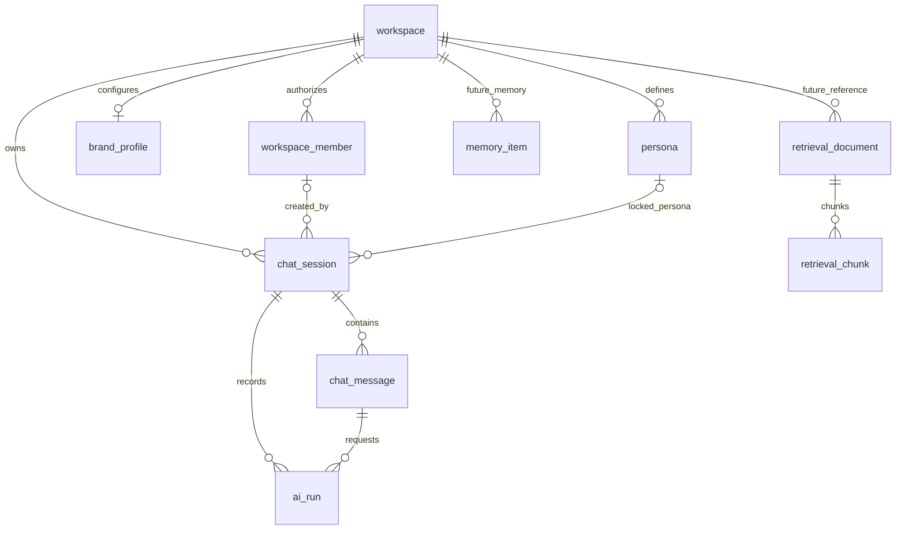

# Lucie Neon database schema — inspected development snapshot

> **Evidence:** full catalog introspection exported by the team on **October 23, 2026**, while Neon `development` was selected. SQL metadata reports database `neondb`, PostgreSQL `18.6`, `public` application schema and managed `neon_auth` tables; the query **cannot independently attest the Neon branch**. This file is **not** a migration script, production schema certification or proof of feature deployment. See [README](README.md) and [ARCHITECTURE](ARCHITECTURE.md).

## Snapshot summary

- **24 `public` tables**, **9 `neon_auth` managed tables**, **51 indexes**, **13 non-internal triggers**, **50 foreign keys**, **35 CHECK constraints**, **10 UNIQUE constraints** and **24 primary keys**. The export also lists 146 Postgres 18 catalog `NOT NULL` constraint records, reflected under each column rather than repeated below.
- All `public` application tables have `rls_enabled=false` and `rls_forced=false`; **no policies** were returned under `pg_policies` for `public`. Application/server authorization must remain in force; RLS/role grants require separate production review.
- Extensions: `pg_session_jwt` 0.5.0, `pgcrypto` 1.4, `plpgsql` 1.0, `vector` 0.8.6. No `vector` similarity-index acceleration (HNSW/IVFFlat) appears among the 51 inspected indexes.
- One application function was surfaced: `public.set_updated_at()` (PL/pgSQL trigger function; no body exported). Triggers below identify which tables use it.
- The original design created storage for more features than currently run in the application. Usage labels below are based on the reviewed Step I/J source and feature guides; they are **not** determined by the SQL schema alone.

## Ownership and relationship model

> This ER diagram intentionally shows **primary conceptual links**, not all 50 SQL foreign keys. In particular, `workspace_member.auth_user_id` links by application convention to Neon Auth identity, **not** by a physical FK from `public` into `neon_auth`. See constraints under each table for actual database-enforced relationships.

### Key safety facts

- **Workspace ID ownership:** most top-level business objects carry `workspace_id`; child tables without it must be authorized by joining through their workspace-owned parent. A resource UUID is not sufficient permission.
- **Workspace environment:** the `workspace.environment` column permits `production`, `staging`, `development`, `test` and defaults to `production`; its value says **nothing** about which Neon branch is active. Controlled development provisioning must set the intended row environment explicitly.
- **Auth distinction:** `neon_auth.organization`/`neon_auth.member` are managed Auth tables, not Lucie `public.workspace` or `public.workspace_member`. Only the application membership model grants Lucie workspace access.
- **RLS disabled:** the inspected DB depends on trustworthy backend scope checks. Do not enable RLS or assume its coverage without an approved design.
- **Soft revocation:** `public.workspace_member` in this export has no `revoked_at` column. Optional compatibility code cannot make that field exist.

## Full table reference

### 1. Identity and workspace configuration

#### `public.workspace`

**Purpose and use:** In use: primary Lucie tenant/business boundary. `environment` is an application label, **not** the actual Neon branch.

| Column | SQL type | Null? | Default / special behavior |
|---|---|:---:|---|
| `id` | `uuid` | No | `gen_random_uuid()` |
| `slug` | `text` | No | — |
| `name` | `text` | No | — |
| `environment` | `text` | No | `'production'::text` |
| `created_at` | `timestamp with time zone` | No | `now()` |
| `updated_at` | `timestamp with time zone` | No | `now()` |

**Primary key:**
- `workspace_pkey` — `PRIMARY KEY (id)`

**Unique constraints:**
- `workspace_slug_key` — `UNIQUE (slug)`

**Checks:**
- `workspace_environment_check` — `CHECK (environment = ANY (ARRAY['production'::text, 'staging'::text, 'development'::text, 'test'::text]))`

**Indexes (including backing PK/UNIQUE indexes):**
- `workspace_pkey` — `CREATE UNIQUE INDEX workspace_pkey ON workspace USING btree (id)`
- `workspace_slug_key` — `CREATE UNIQUE INDEX workspace_slug_key ON workspace USING btree (slug)`

**Triggers:** `trg_workspace_updated` (see `pg_get_triggerdef` in the inspection).

#### `public.workspace_member`

**Purpose and use:** In use: trusted token subject -> workspace and capability-role mapping. **No real FK to `neon_auth.user`.** Memberships currently provisioned manually.

| Column | SQL type | Null? | Default / special behavior |
|---|---|:---:|---|
| `id` | `uuid` | No | `gen_random_uuid()` |
| `workspace_id` | `uuid` | No | — |
| `auth_user_id` | `text` | No | — |
| `role` | `text` | No | `'member'::text` |
| `created_at` | `timestamp with time zone` | No | `now()` |
| `updated_at` | `timestamp with time zone` | No | `now()` |

**Primary key:**
- `workspace_member_pkey` — `PRIMARY KEY (id)`

**Foreign keys:**
- `workspace_member_workspace_id_fkey` — `FOREIGN KEY (workspace_id) REFERENCES workspace(id) ON DELETE CASCADE`

**Unique constraints:**
- `workspace_member_workspace_id_auth_user_id_key` — `UNIQUE (workspace_id, auth_user_id)`

**Checks:**
- `workspace_member_role_check` — `CHECK (role = ANY (ARRAY['owner'::text, 'admin'::text, 'member'::text, 'developer'::text, 'viewer'::text]))`

**Indexes (including backing PK/UNIQUE indexes):**
- `ix_workspace_member_auth_user` — `CREATE INDEX ix_workspace_member_auth_user ON workspace_member USING btree (auth_user_id)`
- `workspace_member_pkey` — `CREATE UNIQUE INDEX workspace_member_pkey ON workspace_member USING btree (id)`
- `workspace_member_workspace_id_auth_user_id_key` — `CREATE UNIQUE INDEX workspace_member_workspace_id_auth_user_id_key ON workspace_member USING btree (workspace_id, auth_user_id)`

**Triggers:** `trg_workspace_member_updated` (see `pg_get_triggerdef` in the inspection).

#### `public.brand_profile`

**Purpose and use:** In use: one shared business profile per workspace; JSONB `settings.licensed_person_name` is the validated licensed-name source.

| Column | SQL type | Null? | Default / special behavior |
|---|---|:---:|---|
| `id` | `uuid` | No | `gen_random_uuid()` |
| `workspace_id` | `uuid` | No | — |
| `business_name` | `text` | No | — |
| `nmls_id` | `text` | Yes | — |
| `dre_number` | `text` | Yes | — |
| `compliance_footer` | `text` | Yes | — |
| `equal_housing_text` | `text` | Yes | — |
| `tone` | `jsonb` | No | `'{}'::jsonb` |
| `values` | `jsonb` | No | `'[]'::jsonb` |
| `keywords` | `text[]` | No | `ARRAY[]::text[]` |
| `catchphrases` | `text[]` | No | `ARRAY[]::text[]` |
| `banned_words` | `text[]` | No | `ARRAY[]::text[]` |
| `blog_examples` | `jsonb` | No | `'[]'::jsonb` |
| `settings` | `jsonb` | No | `'{}'::jsonb` |
| `created_at` | `timestamp with time zone` | No | `now()` |
| `updated_at` | `timestamp with time zone` | No | `now()` |

**Primary key:**
- `brand_profile_pkey` — `PRIMARY KEY (id)`

**Foreign keys:**
- `brand_profile_workspace_id_fkey` — `FOREIGN KEY (workspace_id) REFERENCES workspace(id) ON DELETE CASCADE`

**Unique constraints:**
- `brand_profile_workspace_id_key` — `UNIQUE (workspace_id)`

**Indexes (including backing PK/UNIQUE indexes):**
- `brand_profile_pkey` — `CREATE UNIQUE INDEX brand_profile_pkey ON brand_profile USING btree (id)`
- `brand_profile_workspace_id_key` — `CREATE UNIQUE INDEX brand_profile_workspace_id_key ON brand_profile USING btree (workspace_id)`

**Triggers:** `trg_brand_profile_updated` (see `pg_get_triggerdef` in the inspection).

#### `public.persona`

**Purpose and use:** In use: workspace-owned audiences, editing and generation; `deleted_at` supports soft deletion. Saved chat persona is locked.

| Column | SQL type | Null? | Default / special behavior |
|---|---|:---:|---|
| `id` | `uuid` | No | `gen_random_uuid()` |
| `workspace_id` | `uuid` | No | — |
| `slug` | `text` | No | — |
| `name` | `text` | No | — |
| `description` | `text` | Yes | — |
| `audience_profile` | `jsonb` | No | `'{}'::jsonb` |
| `prompt_guidance` | `text` | Yes | — |
| `is_starter` | `boolean` | No | `false` |
| `deleted_at` | `timestamp with time zone` | Yes | — |
| `created_at` | `timestamp with time zone` | No | `now()` |
| `updated_at` | `timestamp with time zone` | No | `now()` |

**Primary key:**
- `persona_pkey` — `PRIMARY KEY (id)`

**Foreign keys:**
- `persona_workspace_id_fkey` — `FOREIGN KEY (workspace_id) REFERENCES workspace(id) ON DELETE CASCADE`

**Unique constraints:**
- `persona_workspace_id_slug_key` — `UNIQUE (workspace_id, slug)`

**Indexes (including backing PK/UNIQUE indexes):**
- `persona_pkey` — `CREATE UNIQUE INDEX persona_pkey ON persona USING btree (id)`
- `persona_workspace_id_slug_key` — `CREATE UNIQUE INDEX persona_workspace_id_slug_key ON persona USING btree (workspace_id, slug)`

**Triggers:** `trg_persona_updated` (see `pg_get_triggerdef` in the inspection).

#### `public.member_preference`

**Purpose and use:** Schema exists for per-membership preferences; do **not** assume normal chat selection or browser-active chat is synchronized via this table.

| Column | SQL type | Null? | Default / special behavior |
|---|---|:---:|---|
| `id` | `uuid` | No | `gen_random_uuid()` |
| `workspace_member_id` | `uuid` | No | — |
| `selected_persona_id` | `uuid` | Yes | — |
| `preferences` | `jsonb` | No | `'{}'::jsonb` |
| `updated_at` | `timestamp with time zone` | No | `now()` |

**Primary key:**
- `member_preference_pkey` — `PRIMARY KEY (id)`

**Foreign keys:**
- `member_preference_selected_persona_id_fkey` — `FOREIGN KEY (selected_persona_id) REFERENCES persona(id) ON DELETE SET NULL`
- `member_preference_workspace_member_id_fkey` — `FOREIGN KEY (workspace_member_id) REFERENCES workspace_member(id) ON DELETE CASCADE`

**Unique constraints:**
- `member_preference_workspace_member_id_key` — `UNIQUE (workspace_member_id)`

**Indexes (including backing PK/UNIQUE indexes):**
- `member_preference_pkey` — `CREATE UNIQUE INDEX member_preference_pkey ON member_preference USING btree (id)`
- `member_preference_workspace_member_id_key` — `CREATE UNIQUE INDEX member_preference_workspace_member_id_key ON member_preference USING btree (workspace_member_id)`

**Triggers:** `trg_member_preference_updated` (see `pg_get_triggerdef` in the inspection).

### 2. Saved chats and episodic context

#### `public.chat_session`

**Purpose and use:** In use in Step J: workspace-owned durable conversation, original creator attribution, locked persona and reversible archive.

| Column | SQL type | Null? | Default / special behavior |
|---|---|:---:|---|
| `id` | `uuid` | No | `gen_random_uuid()` |
| `workspace_id` | `uuid` | No | — |
| `created_by_member_id` | `uuid` | Yes | — |
| `default_persona_id` | `uuid` | Yes | — |
| `title` | `text` | Yes | — |
| `summary_status` | `text` | No | `'pending'::text` |
| `started_at` | `timestamp with time zone` | No | `now()` |
| `updated_at` | `timestamp with time zone` | No | `now()` |
| `archived_at` | `timestamp with time zone` | Yes | — |

**Primary key:**
- `chat_session_pkey` — `PRIMARY KEY (id)`

**Foreign keys:**
- `chat_session_created_by_member_id_fkey` — `FOREIGN KEY (created_by_member_id) REFERENCES workspace_member(id) ON DELETE SET NULL`
- `chat_session_default_persona_id_fkey` — `FOREIGN KEY (default_persona_id) REFERENCES persona(id) ON DELETE SET NULL`
- `chat_session_workspace_id_fkey` — `FOREIGN KEY (workspace_id) REFERENCES workspace(id) ON DELETE CASCADE`

**Checks:**
- `chat_session_summary_status_check` — `CHECK (summary_status = ANY (ARRAY['pending'::text, 'current'::text, 'stale'::text]))`

**Indexes (including backing PK/UNIQUE indexes):**
- `chat_session_pkey` — `CREATE UNIQUE INDEX chat_session_pkey ON chat_session USING btree (id)`
- `ix_chat_session_workspace_updated` — `CREATE INDEX ix_chat_session_workspace_updated ON chat_session USING btree (workspace_id, updated_at DESC)`

**Triggers:** `trg_chat_session_updated` (see `pg_get_triggerdef` in the inspection).

#### `public.chat_message`

**Purpose and use:** In use in Step J: persisted user/assistant and linked operation/revision/media metadata in `structured_data`; validated author attribution.

| Column | SQL type | Null? | Default / special behavior |
|---|---|:---:|---|
| `id` | `uuid` | No | `gen_random_uuid()` |
| `session_id` | `uuid` | No | — |
| `author_member_id` | `uuid` | Yes | — |
| `persona_id` | `uuid` | Yes | — |
| `role` | `text` | No | — |
| `kind` | `text` | No | `'chat'::text` |
| `mode` | `text` | Yes | — |
| `content` | `text` | No | — |
| `content_format` | `text` | No | `'markdown'::text` |
| `structured_data` | `jsonb` | No | `'{}'::jsonb` |
| `compliance_flags` | `jsonb` | No | `'[]'::jsonb` |
| `client_message_key` | `text` | Yes | — |
| `request_message_id` | `uuid` | Yes | — |
| `source_message_id` | `uuid` | Yes | — |
| `created_at` | `timestamp with time zone` | No | `now()` |

**Primary key:**
- `chat_message_pkey` — `PRIMARY KEY (id)`

**Foreign keys:**
- `chat_message_author_member_id_fkey` — `FOREIGN KEY (author_member_id) REFERENCES workspace_member(id) ON DELETE SET NULL`
- `chat_message_persona_id_fkey` — `FOREIGN KEY (persona_id) REFERENCES persona(id) ON DELETE SET NULL`
- `chat_message_request_message_id_fkey` — `FOREIGN KEY (request_message_id) REFERENCES chat_message(id) ON DELETE SET NULL`
- `chat_message_session_id_fkey` — `FOREIGN KEY (session_id) REFERENCES chat_session(id) ON DELETE CASCADE`
- `chat_message_source_message_id_fkey` — `FOREIGN KEY (source_message_id) REFERENCES chat_message(id) ON DELETE SET NULL`

**Checks:**
- `chat_message_content_format_check` — `CHECK (content_format = ANY (ARRAY['plain_text'::text, 'markdown'::text, 'json'::text]))`
- `chat_message_role_check` — `CHECK (role = ANY (ARRAY['user'::text, 'assistant'::text, 'system'::text, 'tool'::text]))`

**Indexes (including backing PK/UNIQUE indexes):**
- `chat_message_pkey` — `CREATE UNIQUE INDEX chat_message_pkey ON chat_message USING btree (id)`
- `ix_chat_message_session_created` — `CREATE INDEX ix_chat_message_session_created ON chat_message USING btree (session_id, created_at)`
- `uq_chat_message_client_key` — `CREATE UNIQUE INDEX uq_chat_message_client_key ON chat_message USING btree (session_id, client_message_key) WHERE (client_message_key IS NOT NULL)`

#### `public.chat_summary`

**Purpose and use:** Reserved for future rolling episodic summaries; automatic summarization is not implemented end-to-end.

| Column | SQL type | Null? | Default / special behavior |
|---|---|:---:|---|
| `id` | `uuid` | No | `gen_random_uuid()` |
| `session_id` | `uuid` | No | — |
| `through_message_id` | `uuid` | No | — |
| `summary_markdown` | `text` | No | — |
| `token_count` | `integer` | Yes | — |
| `created_at` | `timestamp with time zone` | No | `now()` |

**Primary key:**
- `chat_summary_pkey` — `PRIMARY KEY (id)`

**Foreign keys:**
- `chat_summary_session_id_fkey` — `FOREIGN KEY (session_id) REFERENCES chat_session(id) ON DELETE CASCADE`
- `chat_summary_through_message_id_fkey` — `FOREIGN KEY (through_message_id) REFERENCES chat_message(id) ON DELETE CASCADE`

**Unique constraints:**
- `chat_summary_session_id_through_message_id_key` — `UNIQUE (session_id, through_message_id)`

**Checks:**
- `chat_summary_token_count_check` — `CHECK (token_count IS NULL OR token_count >= 0)`

**Indexes (including backing PK/UNIQUE indexes):**
- `chat_summary_pkey` — `CREATE UNIQUE INDEX chat_summary_pkey ON chat_summary USING btree (id)`
- `chat_summary_session_id_through_message_id_key` — `CREATE UNIQUE INDEX chat_summary_session_id_through_message_id_key ON chat_summary USING btree (session_id, through_message_id)`

### 3. AI run and external provenance

#### `public.ai_run`

**Purpose and use:** In use for persisted provider invocation stages/outcomes and metrics; response ID may be NULL for started/failed calls.

| Column | SQL type | Null? | Default / special behavior |
|---|---|:---:|---|
| `id` | `uuid` | No | `gen_random_uuid()` |
| `session_id` | `uuid` | No | — |
| `request_message_id` | `uuid` | No | — |
| `response_message_id` | `uuid` | Yes | — |
| `provider` | `text` | No | `'anthropic'::text` |
| `model` | `text` | No | — |
| `system_prompt_version` | `text` | No | — |
| `system_prompt_hash` | `text` | No | — |
| `prompt_cache_mode` | `text` | No | `'none'::text` |
| `input_tokens` | `integer` | Yes | — |
| `cache_creation_input_tokens` | `integer` | Yes | — |
| `cache_read_input_tokens` | `integer` | Yes | — |
| `output_tokens` | `integer` | Yes | — |
| `latency_ms` | `integer` | Yes | — |
| `status` | `text` | No | `'started'::text` |
| `error_text` | `text` | Yes | — |
| `created_at` | `timestamp with time zone` | No | `now()` |

**Primary key:**
- `ai_run_pkey` — `PRIMARY KEY (id)`

**Foreign keys:**
- `ai_run_request_message_id_fkey` — `FOREIGN KEY (request_message_id) REFERENCES chat_message(id) ON DELETE RESTRICT`
- `ai_run_response_message_id_fkey` — `FOREIGN KEY (response_message_id) REFERENCES chat_message(id) ON DELETE RESTRICT`
- `ai_run_session_id_fkey` — `FOREIGN KEY (session_id) REFERENCES chat_session(id) ON DELETE CASCADE`

**Unique constraints:**
- `ai_run_response_message_id_key` — `UNIQUE (response_message_id)`

**Checks:**
- `ai_run_cache_creation_input_tokens_check` — `CHECK (cache_creation_input_tokens IS NULL OR cache_creation_input_tokens >= 0)`
- `ai_run_cache_read_input_tokens_check` — `CHECK (cache_read_input_tokens IS NULL OR cache_read_input_tokens >= 0)`
- `ai_run_input_tokens_check` — `CHECK (input_tokens IS NULL OR input_tokens >= 0)`
- `ai_run_latency_ms_check` — `CHECK (latency_ms IS NULL OR latency_ms >= 0)`
- `ai_run_output_tokens_check` — `CHECK (output_tokens IS NULL OR output_tokens >= 0)`
- `ai_run_prompt_cache_mode_check` — `CHECK (prompt_cache_mode = ANY (ARRAY['none'::text, 'automatic'::text, 'explicit'::text]))`
- `ai_run_status_check` — `CHECK (status = ANY (ARRAY['started'::text, 'succeeded'::text, 'failed'::text]))`

**Indexes (including backing PK/UNIQUE indexes):**
- `ai_run_pkey` — `CREATE UNIQUE INDEX ai_run_pkey ON ai_run USING btree (id)`
- `ai_run_response_message_id_key` — `CREATE UNIQUE INDEX ai_run_response_message_id_key ON ai_run USING btree (response_message_id)`
- `ix_ai_run_session_created` — `CREATE INDEX ix_ai_run_session_created ON ai_run USING btree (session_id, created_at DESC)`

#### `public.tool_call`

**Purpose and use:** Provenance schema for tool execution; do not assume full research/tools instrumentation is enabled.

| Column | SQL type | Null? | Default / special behavior |
|---|---|:---:|---|
| `id` | `uuid` | No | `gen_random_uuid()` |
| `ai_run_id` | `uuid` | No | — |
| `tool_name` | `text` | No | — |
| `input_json` | `jsonb` | No | `'{}'::jsonb` |
| `output_json` | `jsonb` | Yes | — |
| `status` | `text` | No | `'started'::text` |
| `error_text` | `text` | Yes | — |
| `started_at` | `timestamp with time zone` | No | `now()` |
| `finished_at` | `timestamp with time zone` | Yes | — |

**Primary key:**
- `tool_call_pkey` — `PRIMARY KEY (id)`

**Foreign keys:**
- `tool_call_ai_run_id_fkey` — `FOREIGN KEY (ai_run_id) REFERENCES ai_run(id) ON DELETE CASCADE`

**Checks:**
- `tool_call_status_check` — `CHECK (status = ANY (ARRAY['started'::text, 'succeeded'::text, 'failed'::text]))`

**Indexes (including backing PK/UNIQUE indexes):**
- `ix_tool_call_run_started` — `CREATE INDEX ix_tool_call_run_started ON tool_call USING btree (ai_run_id, started_at)`
- `tool_call_pkey` — `CREATE UNIQUE INDEX tool_call_pkey ON tool_call USING btree (id)`

#### `public.web_source`

**Purpose and use:** Reference/provenance schema for web sources; do not assume a live web-search feature.

| Column | SQL type | Null? | Default / special behavior |
|---|---|:---:|---|
| `id` | `uuid` | No | `gen_random_uuid()` |
| `tool_call_id` | `uuid` | Yes | — |
| `url` | `text` | No | — |
| `title` | `text` | Yes | — |
| `publisher` | `text` | Yes | — |
| `published_at` | `timestamp with time zone` | Yes | — |
| `accessed_at` | `timestamp with time zone` | No | `now()` |
| `source_metadata` | `jsonb` | No | `'{}'::jsonb` |

**Primary key:**
- `web_source_pkey` — `PRIMARY KEY (id)`

**Foreign keys:**
- `web_source_tool_call_id_fkey` — `FOREIGN KEY (tool_call_id) REFERENCES tool_call(id) ON DELETE SET NULL`

**Indexes (including backing PK/UNIQUE indexes):**
- `ix_web_source_url` — `CREATE INDEX ix_web_source_url ON web_source USING btree (url)`
- `web_source_pkey` — `CREATE UNIQUE INDEX web_source_pkey ON web_source USING btree (id)`

#### `public.message_source`

**Purpose and use:** Junction linking responses to cited web sources; implementation of automatic citations is not established.

| Column | SQL type | Null? | Default / special behavior |
|---|---|:---:|---|
| `message_id` | `uuid` | No | — |
| `web_source_id` | `uuid` | No | — |
| `citation_order` | `integer` | Yes | — |
| `relevance_score` | `numeric(5,4)` | Yes | — |

**Primary key:**
- `message_source_pkey` — `PRIMARY KEY (message_id, web_source_id)`

**Foreign keys:**
- `message_source_message_id_fkey` — `FOREIGN KEY (message_id) REFERENCES chat_message(id) ON DELETE CASCADE`
- `message_source_web_source_id_fkey` — `FOREIGN KEY (web_source_id) REFERENCES web_source(id) ON DELETE CASCADE`

**Checks:**
- `message_source_citation_order_check` — `CHECK (citation_order IS NULL OR citation_order > 0)`
- `message_source_relevance_score_check` — `CHECK (relevance_score IS NULL OR relevance_score >= 0::numeric AND relevance_score <= 1::numeric)`

**Indexes (including backing PK/UNIQUE indexes):**
- `message_source_pkey` — `CREATE UNIQUE INDEX message_source_pkey ON message_source USING btree (message_id, web_source_id)`

### 4. Long-term semantic memory and feedback

#### `public.memory_item`

**Purpose and use:** Future durable semantic memory/corrections; vector field exists, but automatic extraction/retrieval is not implemented.

| Column | SQL type | Null? | Default / special behavior |
|---|---|:---:|---|
| `id` | `uuid` | No | `gen_random_uuid()` |
| `workspace_id` | `uuid` | No | — |
| `source_session_id` | `uuid` | Yes | — |
| `source_message_id` | `uuid` | Yes | — |
| `memory_type` | `text` | No | — |
| `label` | `text` | Yes | — |
| `content` | `text` | No | — |
| `importance` | `smallint` | No | `3` |
| `confidence` | `numeric(4,3)` | No | `1.000` |
| `status` | `text` | No | `'active'::text` |
| `supersedes_memory_id` | `uuid` | Yes | — |
| `embedding_model` | `text` | Yes | `'voyage-4'::text` |
| `embedding` | `vector(1024)` | Yes | — |
| `created_at` | `timestamp with time zone` | No | `now()` |
| `updated_at` | `timestamp with time zone` | No | `now()` |

**Primary key:**
- `memory_item_pkey` — `PRIMARY KEY (id)`

**Foreign keys:**
- `memory_item_source_message_id_fkey` — `FOREIGN KEY (source_message_id) REFERENCES chat_message(id) ON DELETE SET NULL`
- `memory_item_source_session_id_fkey` — `FOREIGN KEY (source_session_id) REFERENCES chat_session(id) ON DELETE SET NULL`
- `memory_item_supersedes_memory_id_fkey` — `FOREIGN KEY (supersedes_memory_id) REFERENCES memory_item(id) ON DELETE SET NULL`
- `memory_item_workspace_id_fkey` — `FOREIGN KEY (workspace_id) REFERENCES workspace(id) ON DELETE CASCADE`

**Checks:**
- `memory_item_confidence_check` — `CHECK (confidence >= 0::numeric AND confidence <= 1::numeric)`
- `memory_item_importance_check` — `CHECK (importance >= 1 AND importance <= 5)`
- `memory_item_memory_type_check` — `CHECK (memory_type = ANY (ARRAY['brand_fact'::text, 'user_preference'::text, 'project_fact'::text, 'decision'::text, 'content_history'::text, 'other'::text]))`
- `memory_item_status_check` — `CHECK (status = ANY (ARRAY['active'::text, 'superseded'::text, 'rejected'::text, 'forgotten'::text]))`

**Indexes (including backing PK/UNIQUE indexes):**
- `ix_memory_item_workspace_status_type` — `CREATE INDEX ix_memory_item_workspace_status_type ON memory_item USING btree (workspace_id, status, memory_type)`
- `memory_item_pkey` — `CREATE UNIQUE INDEX memory_item_pkey ON memory_item USING btree (id)`

**Triggers:** `trg_memory_item_updated` (see `pg_get_triggerdef` in the inspection).

#### `public.ai_run_memory`

**Purpose and use:** Future junction showing which memory items were used by an AI run; not evidence of active semantic recall.

| Column | SQL type | Null? | Default / special behavior |
|---|---|:---:|---|
| `ai_run_id` | `uuid` | No | — |
| `memory_id` | `uuid` | No | — |
| `usage_role` | `text` | No | `'context'::text` |
| `retrieval_rank` | `integer` | Yes | — |
| `similarity_score` | `numeric(7,6)` | Yes | — |

**Primary key:**
- `ai_run_memory_pkey` — `PRIMARY KEY (ai_run_id, memory_id, usage_role)`

**Foreign keys:**
- `ai_run_memory_ai_run_id_fkey` — `FOREIGN KEY (ai_run_id) REFERENCES ai_run(id) ON DELETE CASCADE`
- `ai_run_memory_memory_id_fkey` — `FOREIGN KEY (memory_id) REFERENCES memory_item(id) ON DELETE CASCADE`

**Checks:**
- `ai_run_memory_retrieval_rank_check` — `CHECK (retrieval_rank IS NULL OR retrieval_rank > 0)`
- `ai_run_memory_usage_role_check` — `CHECK (usage_role = ANY (ARRAY['context'::text, 'created'::text, 'updated'::text, 'superseded'::text]))`

**Indexes (including backing PK/UNIQUE indexes):**
- `ai_run_memory_pkey` — `CREATE UNIQUE INDEX ai_run_memory_pkey ON ai_run_memory USING btree (ai_run_id, memory_id, usage_role)`

#### `public.feedback_event`

**Purpose and use:** Future feedback/correction lifecycle; schema exists, but automatic memory rewrite is not implemented.

| Column | SQL type | Null? | Default / special behavior |
|---|---|:---:|---|
| `id` | `uuid` | No | `gen_random_uuid()` |
| `workspace_id` | `uuid` | No | — |
| `message_id` | `uuid` | No | — |
| `submitted_by_member_id` | `uuid` | No | — |
| `memory_id` | `uuid` | Yes | — |
| `feedback_type` | `text` | No | — |
| `comment` | `text` | Yes | — |
| `resolution` | `text` | Yes | — |
| `resolved_at` | `timestamp with time zone` | Yes | — |
| `created_at` | `timestamp with time zone` | No | `now()` |

**Primary key:**
- `feedback_event_pkey` — `PRIMARY KEY (id)`

**Foreign keys:**
- `feedback_event_memory_id_fkey` — `FOREIGN KEY (memory_id) REFERENCES memory_item(id) ON DELETE SET NULL`
- `feedback_event_message_id_fkey` — `FOREIGN KEY (message_id) REFERENCES chat_message(id) ON DELETE CASCADE`
- `feedback_event_submitted_by_member_id_fkey` — `FOREIGN KEY (submitted_by_member_id) REFERENCES workspace_member(id) ON DELETE RESTRICT`
- `feedback_event_workspace_id_fkey` — `FOREIGN KEY (workspace_id) REFERENCES workspace(id) ON DELETE CASCADE`

**Checks:**
- `feedback_event_feedback_type_check` — `CHECK (feedback_type = ANY (ARRAY['helpful'::text, 'not_helpful'::text, 'incorrect'::text, 'wrong_tone'::text, 'wrong_audience'::text, 'remember_this'::text, 'correct_memory'::text, 'forget_memory'::text, 'other'::text]))`

**Indexes (including backing PK/UNIQUE indexes):**
- `feedback_event_pkey` — `CREATE UNIQUE INDEX feedback_event_pkey ON feedback_event USING btree (id)`
- `ix_feedback_workspace_created` — `CREATE INDEX ix_feedback_workspace_created ON feedback_event USING btree (workspace_id, created_at DESC)`

### 5. RAG documents and embeddings

#### `public.retrieval_document`

**Purpose and use:** Future RAG document metadata + normalized Markdown; no full app ingestion pipeline demonstrated.

| Column | SQL type | Null? | Default / special behavior |
|---|---|:---:|---|
| `id` | `uuid` | No | `gen_random_uuid()` |
| `workspace_id` | `uuid` | No | — |
| `uploaded_by_member_id` | `uuid` | Yes | — |
| `source_type` | `text` | No | — |
| `title` | `text` | Yes | — |
| `original_filename` | `text` | Yes | — |
| `source_uri` | `text` | Yes | — |
| `source_mime_type` | `text` | Yes | — |
| `content_hash` | `text` | Yes | — |
| `normalized_markdown` | `text` | Yes | — |
| `ingestion_status` | `text` | No | `'pending'::text` |
| `metadata` | `jsonb` | No | `'{}'::jsonb` |
| `ingested_at` | `timestamp with time zone` | Yes | — |
| `created_at` | `timestamp with time zone` | No | `now()` |
| `updated_at` | `timestamp with time zone` | No | `now()` |

**Primary key:**
- `retrieval_document_pkey` — `PRIMARY KEY (id)`

**Foreign keys:**
- `retrieval_document_uploaded_by_member_id_fkey` — `FOREIGN KEY (uploaded_by_member_id) REFERENCES workspace_member(id) ON DELETE SET NULL`
- `retrieval_document_workspace_id_fkey` — `FOREIGN KEY (workspace_id) REFERENCES workspace(id) ON DELETE CASCADE`

**Unique constraints:**
- `retrieval_document_workspace_id_content_hash_key` — `UNIQUE (workspace_id, content_hash)`

**Checks:**
- `retrieval_document_check` — `CHECK (ingestion_status <> 'ready'::text OR normalized_markdown IS NOT NULL)`
- `retrieval_document_ingestion_status_check` — `CHECK (ingestion_status = ANY (ARRAY['pending'::text, 'processing'::text, 'ready'::text, 'failed'::text]))`
- `retrieval_document_source_type_check` — `CHECK (source_type = ANY (ARRAY['uploaded_file'::text, 'web_page'::text, 'manual_note'::text, 'brand_reference'::text, 'other'::text]))`

**Indexes (including backing PK/UNIQUE indexes):**
- `ix_retrieval_document_workspace_status` — `CREATE INDEX ix_retrieval_document_workspace_status ON retrieval_document USING btree (workspace_id, ingestion_status)`
- `retrieval_document_pkey` — `CREATE UNIQUE INDEX retrieval_document_pkey ON retrieval_document USING btree (id)`
- `retrieval_document_workspace_id_content_hash_key` — `CREATE UNIQUE INDEX retrieval_document_workspace_id_content_hash_key ON retrieval_document USING btree (workspace_id, content_hash)`

**Triggers:** `trg_retrieval_document_updated` (see `pg_get_triggerdef` in the inspection).

#### `public.retrieval_chunk`

**Purpose and use:** Future RAG chunks with `vector(1024)` embeddings; database readiness is not evidence of embeddings being populated.

| Column | SQL type | Null? | Default / special behavior |
|---|---|:---:|---|
| `id` | `uuid` | No | `gen_random_uuid()` |
| `document_id` | `uuid` | No | — |
| `chunk_index` | `integer` | No | — |
| `heading_path` | `text` | Yes | — |
| `content_markdown` | `text` | No | — |
| `token_count` | `integer` | Yes | — |
| `embedding_model` | `text` | No | `'voyage-4'::text` |
| `embedding` | `vector(1024)` | No | — |
| `metadata` | `jsonb` | No | `'{}'::jsonb` |
| `created_at` | `timestamp with time zone` | No | `now()` |

**Primary key:**
- `retrieval_chunk_pkey` — `PRIMARY KEY (id)`

**Foreign keys:**
- `retrieval_chunk_document_id_fkey` — `FOREIGN KEY (document_id) REFERENCES retrieval_document(id) ON DELETE CASCADE`

**Unique constraints:**
- `retrieval_chunk_document_id_chunk_index_key` — `UNIQUE (document_id, chunk_index)`

**Checks:**
- `retrieval_chunk_chunk_index_check` — `CHECK (chunk_index >= 0)`
- `retrieval_chunk_token_count_check` — `CHECK (token_count IS NULL OR token_count >= 0)`

**Indexes (including backing PK/UNIQUE indexes):**
- `ix_retrieval_chunk_document` — `CREATE INDEX ix_retrieval_chunk_document ON retrieval_chunk USING btree (document_id)`
- `retrieval_chunk_document_id_chunk_index_key` — `CREATE UNIQUE INDEX retrieval_chunk_document_id_chunk_index_key ON retrieval_chunk USING btree (document_id, chunk_index)`
- `retrieval_chunk_pkey` — `CREATE UNIQUE INDEX retrieval_chunk_pkey ON retrieval_chunk USING btree (id)`

#### `public.ai_run_retrieval`

**Purpose and use:** Future junction recording retrieved RAG chunks associated with model runs.

| Column | SQL type | Null? | Default / special behavior |
|---|---|:---:|---|
| `ai_run_id` | `uuid` | No | — |
| `chunk_id` | `uuid` | No | — |
| `retrieval_rank` | `integer` | Yes | — |
| `similarity_score` | `numeric(7,6)` | Yes | — |

**Primary key:**
- `ai_run_retrieval_pkey` — `PRIMARY KEY (ai_run_id, chunk_id)`

**Foreign keys:**
- `ai_run_retrieval_ai_run_id_fkey` — `FOREIGN KEY (ai_run_id) REFERENCES ai_run(id) ON DELETE CASCADE`
- `ai_run_retrieval_chunk_id_fkey` — `FOREIGN KEY (chunk_id) REFERENCES retrieval_chunk(id) ON DELETE CASCADE`

**Checks:**
- `ai_run_retrieval_retrieval_rank_check` — `CHECK (retrieval_rank IS NULL OR retrieval_rank > 0)`

**Indexes (including backing PK/UNIQUE indexes):**
- `ai_run_retrieval_pkey` — `CREATE UNIQUE INDEX ai_run_retrieval_pkey ON ai_run_retrieval USING btree (ai_run_id, chunk_id)`

### 6. Marketing, content, calendar, CRM

#### `public.campaign`

**Purpose and use:** Structured campaign model reserved for broader marketing persistence; rendered chat campaign outputs do not prove persistence here.

| Column | SQL type | Null? | Default / special behavior |
|---|---|:---:|---|
| `id` | `uuid` | No | `gen_random_uuid()` |
| `workspace_id` | `uuid` | No | — |
| `name` | `text` | No | — |
| `objective` | `text` | Yes | — |
| `status` | `text` | No | `'draft'::text` |
| `start_date` | `date` | Yes | — |
| `end_date` | `date` | Yes | — |
| `created_at` | `timestamp with time zone` | No | `now()` |
| `updated_at` | `timestamp with time zone` | No | `now()` |

**Primary key:**
- `campaign_pkey` — `PRIMARY KEY (id)`

**Foreign keys:**
- `campaign_workspace_id_fkey` — `FOREIGN KEY (workspace_id) REFERENCES workspace(id) ON DELETE CASCADE`

**Checks:**
- `campaign_check` — `CHECK (end_date IS NULL OR start_date IS NULL OR end_date >= start_date)`
- `campaign_status_check` — `CHECK (status = ANY (ARRAY['draft'::text, 'active'::text, 'completed'::text, 'archived'::text]))`

**Indexes (including backing PK/UNIQUE indexes):**
- `campaign_pkey` — `CREATE UNIQUE INDEX campaign_pkey ON campaign USING btree (id)`

**Triggers:** `trg_campaign_updated` (see `pg_get_triggerdef` in the inspection).

#### `public.campaign_persona`

**Purpose and use:** Junction between structured campaigns and personas; not proof of a deployed campaign manager.

| Column | SQL type | Null? | Default / special behavior |
|---|---|:---:|---|
| `campaign_id` | `uuid` | No | — |
| `persona_id` | `uuid` | No | — |
| `persona_role` | `text` | No | `'primary'::text` |

**Primary key:**
- `campaign_persona_pkey` — `PRIMARY KEY (campaign_id, persona_id)`

**Foreign keys:**
- `campaign_persona_campaign_id_fkey` — `FOREIGN KEY (campaign_id) REFERENCES campaign(id) ON DELETE CASCADE`
- `campaign_persona_persona_id_fkey` — `FOREIGN KEY (persona_id) REFERENCES persona(id) ON DELETE RESTRICT`

**Checks:**
- `campaign_persona_persona_role_check` — `CHECK (persona_role = ANY (ARRAY['primary'::text, 'secondary'::text]))`

**Indexes (including backing PK/UNIQUE indexes):**
- `campaign_persona_pkey` — `CREATE UNIQUE INDEX campaign_persona_pkey ON campaign_persona USING btree (campaign_id, persona_id)`
- `uq_campaign_one_primary_persona` — `CREATE UNIQUE INDEX uq_campaign_one_primary_persona ON campaign_persona USING btree (campaign_id) WHERE (persona_role = 'primary'::text)`

#### `public.content_item`

**Purpose and use:** Structured marketing asset storage; current chat saves artifacts in messages and calendar remains local.

| Column | SQL type | Null? | Default / special behavior |
|---|---|:---:|---|
| `id` | `uuid` | No | `gen_random_uuid()` |
| `workspace_id` | `uuid` | No | — |
| `campaign_id` | `uuid` | Yes | — |
| `source_message_id` | `uuid` | Yes | — |
| `persona_id` | `uuid` | Yes | — |
| `title` | `text` | Yes | — |
| `content_type` | `text` | No | — |
| `platform` | `text` | Yes | — |
| `status` | `text` | No | `'draft'::text` |
| `body_markdown` | `text` | No | — |
| `structured_data` | `jsonb` | No | `'{}'::jsonb` |
| `approved_at` | `timestamp with time zone` | Yes | — |
| `created_at` | `timestamp with time zone` | No | `now()` |
| `updated_at` | `timestamp with time zone` | No | `now()` |

**Primary key:**
- `content_item_pkey` — `PRIMARY KEY (id)`

**Foreign keys:**
- `content_item_campaign_id_fkey` — `FOREIGN KEY (campaign_id) REFERENCES campaign(id) ON DELETE SET NULL`
- `content_item_persona_id_fkey` — `FOREIGN KEY (persona_id) REFERENCES persona(id) ON DELETE SET NULL`
- `content_item_source_message_id_fkey` — `FOREIGN KEY (source_message_id) REFERENCES chat_message(id) ON DELETE SET NULL`
- `content_item_workspace_id_fkey` — `FOREIGN KEY (workspace_id) REFERENCES workspace(id) ON DELETE CASCADE`

**Checks:**
- `content_item_status_check` — `CHECK (status = ANY (ARRAY['draft'::text, 'approved'::text, 'published'::text, 'archived'::text]))`

**Indexes (including backing PK/UNIQUE indexes):**
- `content_item_pkey` — `CREATE UNIQUE INDEX content_item_pkey ON content_item USING btree (id)`
- `ix_content_item_campaign` — `CREATE INDEX ix_content_item_campaign ON content_item USING btree (campaign_id)`
- `ix_content_item_workspace_status` — `CREATE INDEX ix_content_item_workspace_status ON content_item USING btree (workspace_id, status)`

**Triggers:** `trg_content_item_updated` (see `pg_get_triggerdef` in the inspection).

#### `public.calendar_entry`

**Purpose and use:** Structured calendar schema exists, but current Calendar feature remains browser-local (not cross-device DB sync).

| Column | SQL type | Null? | Default / special behavior |
|---|---|:---:|---|
| `id` | `uuid` | No | `gen_random_uuid()` |
| `workspace_id` | `uuid` | No | — |
| `content_item_id` | `uuid` | Yes | — |
| `title` | `text` | No | — |
| `scheduled_for` | `timestamp with time zone` | No | — |
| `timezone` | `text` | No | `'America/Los_Angeles'::text` |
| `status` | `text` | No | `'planned'::text` |
| `notes` | `text` | Yes | — |
| `created_at` | `timestamp with time zone` | No | `now()` |
| `updated_at` | `timestamp with time zone` | No | `now()` |

**Primary key:**
- `calendar_entry_pkey` — `PRIMARY KEY (id)`

**Foreign keys:**
- `calendar_entry_content_item_id_fkey` — `FOREIGN KEY (content_item_id) REFERENCES content_item(id) ON DELETE SET NULL`
- `calendar_entry_workspace_id_fkey` — `FOREIGN KEY (workspace_id) REFERENCES workspace(id) ON DELETE CASCADE`

**Checks:**
- `calendar_entry_status_check` — `CHECK (status = ANY (ARRAY['planned'::text, 'ready'::text, 'published'::text, 'cancelled'::text]))`

**Indexes (including backing PK/UNIQUE indexes):**
- `calendar_entry_pkey` — `CREATE UNIQUE INDEX calendar_entry_pkey ON calendar_entry USING btree (id)`
- `ix_calendar_entry_workspace_scheduled` — `CREATE INDEX ix_calendar_entry_workspace_scheduled ON calendar_entry USING btree (workspace_id, scheduled_for)`

**Triggers:** `trg_calendar_entry_updated` (see `pg_get_triggerdef` in the inspection).

#### `public.contact`

**Purpose and use:** Light CRM schema foundation. No full contact-management UI/integration verified.

| Column | SQL type | Null? | Default / special behavior |
|---|---|:---:|---|
| `id` | `uuid` | No | `gen_random_uuid()` |
| `workspace_id` | `uuid` | No | — |
| `external_ref` | `text` | Yes | — |
| `display_name` | `text` | Yes | — |
| `email` | `text` | Yes | — |
| `phone` | `text` | Yes | — |
| `source` | `text` | Yes | — |
| `notes` | `text` | Yes | — |
| `created_at` | `timestamp with time zone` | No | `now()` |
| `updated_at` | `timestamp with time zone` | No | `now()` |

**Primary key:**
- `contact_pkey` — `PRIMARY KEY (id)`

**Foreign keys:**
- `contact_workspace_id_fkey` — `FOREIGN KEY (workspace_id) REFERENCES workspace(id) ON DELETE CASCADE`

**Unique constraints:**
- `contact_workspace_id_external_ref_key` — `UNIQUE (workspace_id, external_ref)`

**Indexes (including backing PK/UNIQUE indexes):**
- `contact_pkey` — `CREATE UNIQUE INDEX contact_pkey ON contact USING btree (id)`
- `contact_workspace_id_external_ref_key` — `CREATE UNIQUE INDEX contact_workspace_id_external_ref_key ON contact USING btree (workspace_id, external_ref)`

**Triggers:** `trg_contact_updated` (see `pg_get_triggerdef` in the inspection).

#### `public.lead`

**Purpose and use:** Light lead attribution/follow-up schema foundation. No full production lead pipeline verified.

| Column | SQL type | Null? | Default / special behavior |
|---|---|:---:|---|
| `id` | `uuid` | No | `gen_random_uuid()` |
| `workspace_id` | `uuid` | No | — |
| `contact_id` | `uuid` | Yes | — |
| `source_content_item_id` | `uuid` | Yes | — |
| `source_channel` | `text` | Yes | — |
| `status` | `text` | No | `'new'::text` |
| `notes` | `text` | Yes | — |
| `created_at` | `timestamp with time zone` | No | `now()` |
| `updated_at` | `timestamp with time zone` | No | `now()` |

**Primary key:**
- `lead_pkey` — `PRIMARY KEY (id)`

**Foreign keys:**
- `lead_contact_id_fkey` — `FOREIGN KEY (contact_id) REFERENCES contact(id) ON DELETE SET NULL`
- `lead_source_content_item_id_fkey` — `FOREIGN KEY (source_content_item_id) REFERENCES content_item(id) ON DELETE SET NULL`
- `lead_workspace_id_fkey` — `FOREIGN KEY (workspace_id) REFERENCES workspace(id) ON DELETE CASCADE`

**Checks:**
- `lead_status_check` — `CHECK (status = ANY (ARRAY['new'::text, 'contacted'::text, 'qualified'::text, 'converted'::text, 'closed'::text]))`

**Indexes (including backing PK/UNIQUE indexes):**
- `ix_lead_contact` — `CREATE INDEX ix_lead_contact ON lead USING btree (contact_id)`
- `ix_lead_workspace_status` — `CREATE INDEX ix_lead_workspace_status ON lead USING btree (workspace_id, status)`
- `lead_pkey` — `CREATE UNIQUE INDEX lead_pkey ON lead USING btree (id)`

**Triggers:** `trg_lead_updated` (see `pg_get_triggerdef` in the inspection).

## Neon Auth managed schema

The schema export lists these **managed table names only**; it intentionally did not read user accounts, password hashes, sessions or signing keys. Do **not** try to define or alter these tables as part of a Lucie application migration:

- `neon_auth.account`
- `neon_auth.invitation`
- `neon_auth.jwks`
- `neon_auth.member`
- `neon_auth.organization`
- `neon_auth.project_config`
- `neon_auth.session`
- `neon_auth.user`
- `neon_auth.verification`

The currently applicable identity mapping is `public.workspace_member.auth_user_id` (`text`) to the verified Neon Auth subject; there is no inspected physical foreign key to managed Auth. Any Neon Auth schema/version changes require the provider documentation and a separate environment-specific validation.

## What the snapshot cannot prove

- **No live row contents** or account/lead/chat records were exported. Table existence does not prove active feature usage, seeded persona data, completed migrations or row-level correctness.
- **No Git migration lineage** was exported. Existing tables/constraints may predate recent Step J code; inspect the intended branch and actual migration files before planning DDL.
- **No database grants, role memberships, connection role privileges, backups or production branch metadata** were exported. Those need a distinct environment/permissions audit.
- A development workspace whose `environment` value is `production` could still reside on the development Neon branch: do not conflate the two notions of environment.
- The presence of `vector(1024)` and `voyage-4` defaults does not demonstrate any embeddings have been generated, indexed or retrieved in production.

## Source/method and upkeep

Source: one of four byte-identical copies of a read-only PostgreSQL catalog query supplied in this conversation. Counts are from the exported catalog. The schema file includes **no real data rows, project connection strings, private workspace UUIDs or customer conversations**. Column defaults and constraint expressions were checked for obvious private data before packaging, but should still undergo normal repository review/secret scanning.

When schema changes: (1) verify the target **Neon branch**, (2) obtain an approved migration and its rollback plan, (3) re-export read-only metadata after application, (4) regenerate/review this reference, (5) update [ARCHITECTURE](ARCHITECTURE.md), [WORKFLOWS](WORKFLOWS.md) and relevant maintained API docs. **Do not execute the original architecture-v2 SQL as a production migration.**
